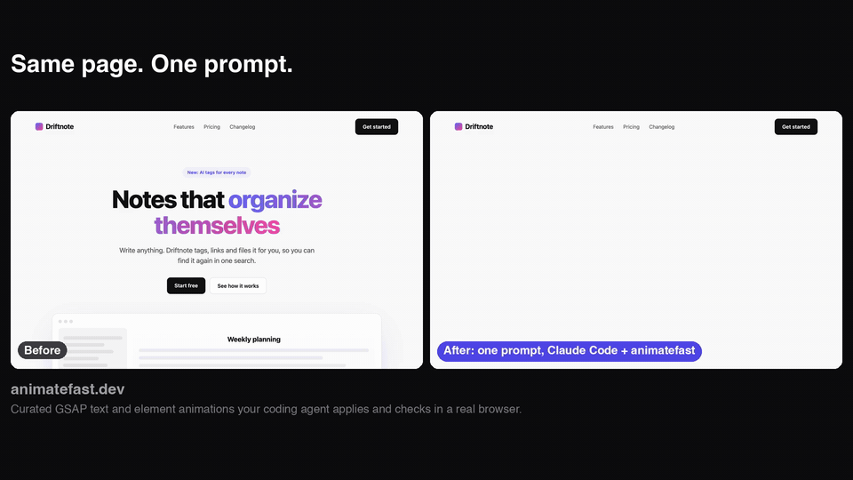

# animatefast

Your AI coding agent adds tasteful text and element animations to a Webflow site or HTML page from a plain-language request, then checks them in a real browser.



*Same page, one prompt in Claude Code. Left: before. Right: after.*

## Install

```bash
npx skills add wojtekwoz/animatefast
```

This uses the skills CLI and works for Claude Code, Codex, Cursor and other agents.

The browser check needs puppeteer-core once. The agent runs `npm install` in the skill folder the first time verify asks for it, or you can run it yourself.

Needs Node 22.12 or newer and a local Chrome or Chromium.

Then ask your agent, for example: "Animate this landing page, it's a calm architecture studio" or "Niech nagłówek wchodzi słowo po słowie".

### Manual install

```bash
git clone https://github.com/wojtekwoz/animatefast ~/.claude/skills/animatefast && npm --prefix ~/.claude/skills/animatefast install
```

This installs the skill plus puppeteer-core for the browser check, which uses your local Chrome (no browser download).

For Codex, Cursor and others, also paste the block from [`AGENTS.md`](AGENTS.md) into your project's `AGENTS.md` or Cursor rules.

## How it works

You describe the motion in plain words ("make the headline come in word by word"). The agent picks one of 12 tuned GSAP effects, writes one `data-motion` attribute, keeps it on brand with your project's `MOTION.md` styleguide, and checks in a real browser that it works.

Early preview (v0.1.2). Made by the people behind gFLUO, the Webflow app for no-code GSAP text animations. Site: [animatefast.dev](https://animatefast.dev).

## What's inside

| path | what |
|---|---|
| [`SKILL.md`](SKILL.md) | the workflow your agent follows (styleguide, pick, apply, verify) |
| [`references/SPEC.md`](references/SPEC.md) | the 12 effects, attributes, defaults, styleguide tokens, presets and rules. Same as [`llms.txt`](llms.txt) |
| [`templates/MOTION.md`](templates/MOTION.md) | brand motion styleguide template (presets: calm, playful, bold) |
| [`dist/animatefast-lite.min.js`](dist/animatefast-lite.min.js) | the runtime (6.4 KB, 2.7 KB gzipped). Needs GSAP 3.15 + ScrollTrigger + SplitText, all free |
| [`scripts/lint.cjs`](scripts/lint.cjs), [`scripts/verify.cjs`](scripts/verify.cjs) | checks the agent runs before it says done |
| [`examples/sample.html`](examples/sample.html) | a plain page to try it on |

## Using the script without the agent

In `<head>`:

```html
<style>.js [data-motion]:not([data-motion-ready]){visibility:hidden}.ms-reveal [data-motion]{visibility:visible!important}@media (prefers-reduced-motion:reduce){[data-motion]{visibility:visible!important}}</style>
<script>document.documentElement.className+=" js";setTimeout(function(){document.documentElement.className+=" ms-reveal"},3000)</script>
<script src="https://cdn.jsdelivr.net/npm/gsap@3.15.1/dist/gsap.min.js" defer></script>
<script src="https://cdn.jsdelivr.net/npm/gsap@3.15.1/dist/ScrollTrigger.min.js" defer></script>
<script src="https://cdn.jsdelivr.net/npm/gsap@3.15.1/dist/SplitText.min.js" defer></script>
<script src="https://cdn.jsdelivr.net/gh/wojtekwoz/animatefast@v0.1.2/dist/animatefast-lite.min.js" integrity="sha384-NduON8+acxhHUZVpchMMEz+smjiRFa/dnz/paVPxRatiDv1bV09pnceoIfmdMT5/" crossorigin="anonymous" defer></script>
```

In `<body>`:

```html
<h1 data-motion="word-slide-up" data-motion-trigger="load">Hello</h1>
```

Use `data-motion-trigger="load"` for anything in the first screen; everything else animates on scroll by default.

Using Webflow's GSAP toggle instead of loading GSAP yourself, pasting the script inline, or self-hosting it: see `references/SPEC.md` section 1.

## License

MIT, see [`LICENSE`](LICENSE). GSAP is not included; it loads from jsDelivr under the GSAP Standard License.
